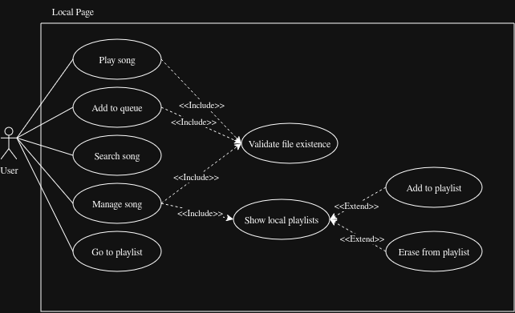

# 
⭐️ Spot-MP ⭐️

---
### Grafico Representativo de Local Page:

---
### Casos de Uso Principales

| Caso de uso: PlaySong |
| --- |
| **ID:** 1 |
| **Breve descripción:**   El Usuario inicia la reproducción de una canción local seleccionada. |
| **Actores principales:** Usuario |
| **Actores secundarios:** Ninguno |
| **Precondiciones:**   1. El Usuario se encuentra en la pantalla Local Page.   2. Existe al menos una canción listada. |
| **Flujo principal:**   1. El caso de uso empieza cuando el Usuario selecciona "reproducir" en una canción específica.   2. include(ValidateFileExistence).   3. El sistema carga los metadatos y la ruta de la canción en el reproductor.   4. El sistema inicia el flujo de audio local. |
| **Postcondiciones:**   1. El reproductor general se encuentra reproduciendo la canción seleccionada. |
| **Flujos alternativos:**   Ninguno. |

| Caso de uso: AddToQueue |
| --- |
| **ID:** 2 |
| **Breve descripción:**   El Usuario envía una canción local a la cola del reproductor para que se escuche a continuación. |
| **Actores principales:** Usuario |
| **Actores secundarios:** Ninguno |
| **Precondiciones:**   1. El Usuario se encuentra en la pantalla Local Page. |
| **Flujo principal:**   1. El caso de uso empieza cuando el Usuario selecciona "agregar a la cola" en una canción.   2. include(ValidateFileExistence).   3. El sistema añade la canción a la estructura de datos de la cola de reproducción.   4. El sistema notifica al Usuario que la canción fue añadida con éxito. |
| **Postcondiciones:**   1. La canción se encuentra encolada con prioridad de reproducción. |
| **Flujos alternativos:**   Ninguno. |

| Caso de uso: SearchSong |
| --- |
| **ID:** 3 |
| **Breve descripción:**   El Usuario filtra el listado de canciones locales ingresando un texto de búsqueda. |
| **Actores principales:** Usuario |
| **Actores secundarios:** Ninguno |
| **Precondiciones:**  1. Existen canciones cargadas en el directorio raíz local. |
| **Flujo principal:**  1. El caso de uso empieza cuando el Usuario ingresa caracteres en la barra de búsqueda.  2. El sistema filtra las canciones comparando el texto con los metadatos (Título, Autor, Álbum).  3. El sistema actualiza la lista mostrada en pantalla con las coincidencias. |
| **Postcondiciones:**  1. La pantalla muestra únicamente las canciones que coinciden con los criterios. |
| **Flujos alternativos:**  Ninguno. |

| Caso de uso: ManageSong |
| --- |
| **ID:** 4 |
| **Breve descripción:**   El Usuario solicita abrir las opciones de gestión de listas de reproducción para una canción. |
| **Actores principales:** Usuario |
| **Actores secundarios:** Ninguno |
| **Precondiciones:**  1. El Usuario se encuentra en la pantalla Local Page. |
| **Flujo principal:**  1. El caso de uso empieza cuando el Usuario abre el menú de gestión de una canción.  2. include(ValidateFileExistence).  3. include(ShowLocalPlaylists). |
| **Postcondiciones:**   1. El menú de listas de reproducción está desplegado para la canción elegida. |
| **Flujos alternativos:**   Ninguno. |

| Caso de uso: Go to playlist |
| --- |
| **ID:** 21 |
| **Breve descripción:**   Cuando el usuario interactua con la playlist el sistema va hacia la página de playlist. |
| **Actores principales:** Usuario |
| **Actores secundarios:** Sistema |
| **Precondiciones:**  1. El Usuario se encuentra en la pantalla Local Page.  2. El usuario tiene seleccionada una playlist.|
| **Flujo principal:**  1. El caso de uso empieza cuando el usuario apreta click o enter cuando se esta seleccionando una playlist.  2. El sistema se encarga de cargar la página de playlists.  3. El sistema abre la estructura de arbol de la playlist previmente seleccionada. |
| **Postcondiciones:**   1. El sistema se encuentra en la pantalla playlists.  2. La playlist en cuestion se encuentra desplegada. |
| **Flujos alternativos:**   Ninguno. |
---

### Casos de Uso de Inclusión (`<<include>>`)

| Caso de uso: ValidateFileExistence |
| --- |
| **ID:** 5 |
| **Breve descripción:**  El sistema verifica de forma interna que el archivo físico de la canción no haya sido movido o borrado del disco. |
| **Actores principales:** Sistema |
| **Actores secundarios:** Ninguno |
| **Precondiciones:**  1. Se ha seleccionado una canción local válida en la interfaz. |
| **Flujo principal:**   1. El sistema lee la ruta absoluta del archivo.   2. El sistema consulta al sistema operativo por la existencia del archivo en dicha ruta. |
| **Postcondiciones:**  1. El sistema confirma que el archivo está accesible. |
| **Flujos alternativos:**   ArchivoNoEncontrado. |

| Flujo alternativo: ValidateFileExistence:ArchivoNoEncontrado |
| --- |
| **ID:** 5.1 |
| **Breve descripción:**  El sistema detecta que el archivo físico de audio ya no existe y aborta la operación. |
| **Actores principales:** Sistema |
| **Actores secundarios:** Ninguno |
| **Precondiciones:**  1. El archivo físico ha sido eliminado o movido fuera de Spot-MP. |
| **Flujo alternativo:**  1. El flujo alternativo empieza después del paso 2 del flujo principal.  2. El sistema alerta visualmente al Usuario: "El archivo no se encuentra disponible".   3. El sistema cancela el caso de uso base que desencadenó esta validación. |
| **Postcondiciones:**   1. La acción original es cancelada de manera segura. |

| Caso de uso: ShowLocalPlaylists |
| --- |
| **ID:** 6 |
| **Breve descripción:**  El sistema despliega las listas de playlist locales y provee enganches para su modificación. |
| **Actores principales:** Sistema |
| **Actores secundarios:** Ninguno |
| **Precondiciones:**  1. La validación del archivo fue exitosa. |
| **Flujo principal:**  1. El sistema lee de la base de datos  todas las playlists locales existentes.  2. El sistema muestra la lista de playlists.   punto de extensión: interaccionPlaylist|
| **Postcondiciones:**   1. Las playlists están visibles y listas para interactuar. |
| **Flujos alternativos:**  Ninguno. |

---

### Casos de Uso de Extensión (`<<extend>>`)

| Caso de uso de extensión: AddToPlaylist |
| --- |
| **ID:** 7 |
| **Breve descripción:**   Segmento 1: El Usuario vincula la canción seleccionada a una lista de reproducción existente. |
| **Actores principales:** Usuario |
| **Actores secundarios:** Ninguno |
| **Segmento 1 precondiciones:**  1. La canción actual no pertenece a la playlist seleccionada por el Usuario. |
| **Segmento 1 flujo:**  1. El Usuario marca una playlist específica para agregar la canción.  . El sistema registra el vínculo en la base de datos de la playlist virtual.  3. El sistema actualiza el estado visual del botón indicando inclusión. |
| **Segmento 1 postcondiciones:**   1. La canción forma parte de la playlist seleccionada. |

| Caso de uso de extensión: EraseFromPlaylist |
| --- |
| **ID:** 8 |
| **Breve descripción:**   Segmento 1: El Usuario desvincula la canción de una lista de reproducción a la que ya pertenecía. |
| **Actores principales:** Usuario |
| **Actores secundarios:** Ninguno |
| **Segmento 1 precondiciones:**   1. La canción actual pertenece formalmente a la playlist seleccionada. |
| **Segmento 1 flujo:**  1. El Usuario desmarca la playlist específica para retirar la canción.  2. El sistema elimina el vínculo en la base de datos de la playlist virtual.  3. El sistema actualiza el estado visual del botón indicando exclusión. |
| **Segmento 1 postcondiciones:**  1. La canción ha sido removida de la playlist seleccionada. |