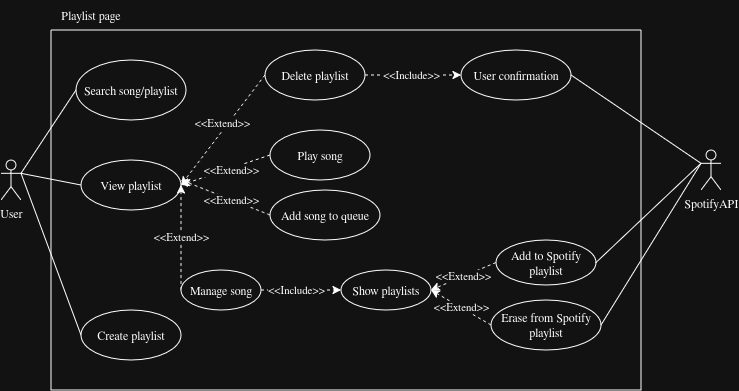

# 
⭐️ Spot-MP ⭐️

---

#### Gráfico Representativo de Playlist Page:

#### Casos de Uso Principales (Base)

| Caso de uso: View playlist |
| ------ |
| **ID:** 24 |
| **Breve descripción:**   El Usuario visualiza una playlist local o importada, desplegando su contenido en una estructura de árbol. |
| **Actores principales:** Usuario |
| **Actores secundarios:** Ninguno |
| **Precondiciones:**   1. El Usuario se encuentra en la pantalla de Playlist Page. |
| **Flujo principal:**   1. El caso de uso empieza cuando el Usuario interactúa con una playlist de la lista.   2. El sistema despliega la playlist mostrando sus canciones como hojas del árbol.   punto de extensión: Interacciones de Playlist (Delete playlist) e Interacciones de Canción (Play song, Add song to queue, Manage song). |
| **Postcondiciones:**   1. El contenido de la playlist es visible para el Usuario. |
| **Flujos alternativos:**   Ninguno. |

| Caso de uso: Create playlist |
| ------ |
| **ID:** 25 |
| **Breve descripción:**   El Usuario crea una nueva playlist local (mixta) desde la interfaz. |
| **Actores principales:** Usuario |
| **Actores secundarios:** Ninguno |
| **Precondiciones:**   1. El Usuario se encuentra en la pantalla de Playlist Page. |
| **Flujo principal:**   1. El caso de uso empieza cuando el Usuario acciona la línea superior destinada a la creación de listas.   2. El sistema solicita el nombre para la nueva playlist.   3. El sistema crea y guarda la nueva playlist local (mixta) en la base de datos virtual.   4. El sistema actualiza la interfaz mostrando la nueva playlist. |
| **Postcondiciones:**   1. Una nueva playlist mixta ha sido creada y está lista para recibir canciones. |
| **Flujos alternativos:**   CreacionCancelada. |

| Caso de uso: Search song/playlist |
| ------ |
| **ID:** 26 |
| **Breve descripción:**   El Usuario utiliza la búsqueda para filtrar las playlists o canciones mostradas en la página. |
| **Actores principales:** Usuario |
| **Actores secundarios:** Ninguno |
| **Precondiciones:**   1. Existen playlists y/o canciones cargadas en la Playlist Page. |
| **Flujo principal:**   1. El caso de uso empieza cuando el Usuario ingresa un término en el buscador de la página.   2. El sistema filtra las playlists locales y de Spotify, así como las canciones, basándose en el texto ingresado.   3. El sistema actualiza la vista mostrando únicamente las coincidencias. |
| **Postcondiciones:**   1. La interfaz exhibe solo los elementos que coinciden con la búsqueda. |
| **Flujos alternativos:**   Ninguno. |

---

#### Casos de Uso de Extensión (`<<extend>>`)

| Caso de uso de extensión: Delete playlist |
| ------ |
| **ID:** 27 |
| **Breve descripción:**   Segmento 1: El Usuario decide eliminar una playlist (local) desde la vista desplegada. |
| **Actores principales:** Usuario |
| **Actores secundarios:** Ninguno |
| **Segmento 1 precondiciones:**   1. El Usuario ha desplegado o seleccionado una playlist en la Playlist Page. |
| **Segmento 1 flujo:**   1. El Usuario presiona el botón de eliminar correspondiente a la playlist.   2. include(User Confirmation).   3. El sistema elimina la playlist de la base de datos local. 4. Si la playlist es de Spotify el sistema se encarga de eliminarla en Spotify mediante su API.   5. El sistema actualiza la interfaz gráfica removiendo la playlist eliminada. |
| **Segmento 1 postcondiciones:**   1. La playlist deja de existir en el almacenamiento local del sistema. |

| Caso de uso de extensión: Play song |
| ------ |
| **ID:** 28 |
| **Breve descripción:**   Segmento 1: El Usuario inicia la reproducción de una canción directamente desde el interior de una playlist. |
| **Actores principales:** Usuario |
| **Actores secundarios:** Ninguno |
| **Segmento 1 precondiciones:**   1. El Usuario está visualizando las canciones dentro de una playlist (View playlist). |
| **Segmento 1 flujo:**   1. El Usuario presiona el botón de play ubicado a la izquierda del nombre de la canción.   2. El sistema configura el flujo de reproducción (Normal o Random) comenzando desde esa canción en adelante.   3. El sistema envía la orden de reproducción al motor general de audio. |
| **Segmento 1 postcondiciones:**   1. La canción seleccionada comienza a reproducirse y el flujo de la playlist queda configurado. |

| Caso de uso de extensión: Add song to queue |
| ------ |
| **ID:** 29 |
| **Breve descripción:**   Segmento 1: El Usuario envía una canción específica de la playlist a la cola de reproducción. |
| **Actores principales:** Usuario |
| **Actores secundarios:** Ninguno |
| **Segmento 1 precondiciones:**   1. El Usuario está visualizando las canciones dentro de una playlist (View playlist). |
| **Segmento 1 flujo:**   1. El Usuario selecciona la opción de agregar a la cola a través del botón de gestión (tres puntos).   2. El sistema añade la canción seleccionada a la cola de prioridad del reproductor general. |
| **Segmento 1 postcondiciones:**   1. La canción queda programada en la cola de reproducción. |

| Caso de uso de extensión: Manage song |
| ------ |
| **ID:** 30 |
| **Breve descripción:**   Segmento 1: El Usuario abre el menú de opciones de una canción dentro de la playlist para gestionar a qué otras listas pertenece. |
| **Actores principales:** Usuario |
| **Actores secundarios:** Ninguno |
| **Segmento 1 precondiciones:**   1. El Usuario está visualizando las canciones dentro de una playlist (View playlist). |
| **Segmento 1 flujo:**   1. El Usuario presiona el botón de tres puntos ubicado a la derecha de la duración de la canción.   2. include(Show playlists). |
| **Segmento 1 postcondiciones:**   1. El menú contextual de listas (tanto locales como de Spotify) se despliega para que el Usuario pueda añadir o eliminar la canción de otras playlists. |