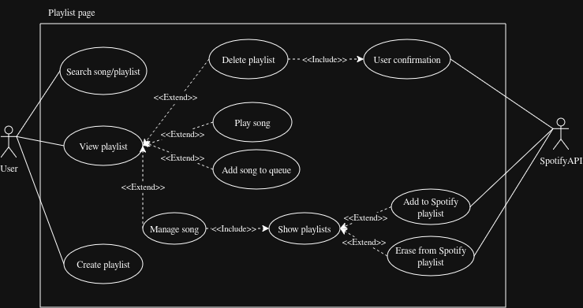

# 
⭐️ Spot-MP ⭐️

---

#### Gráfico Representativo de Playlist Page:

#### Casos de Uso Principales (Base)

| Caso de uso: View playlist |
| ------ |
| **ID:** 24 |
| **Breve descripción:**   El Usuario visualiza una playlist local o importada, desplegando su contenido en una estructura de árbol. |
| **Actores principales:** Usuario |
| **Actores secundarios:** Ninguno |
| **Precondiciones:**   1. El Usuario se encuentra en la pantalla de Playlist Page. |
| **Flujo principal:**   1. El caso de uso empieza cuando el Usuario interactúa con una playlist de la lista.   2. El sistema despliega la playlist mostrando sus canciones como hojas del árbol.   punto de extensión: Interacciones de Playlist (Delete playlist) e Interacciones de Canción (Play song, Add song to queue, Manage song). |
| **Postcondiciones:**   1. El contenido de la playlist es visible para el Usuario. |
| **Flujos alternativos:**   Ninguno. |

| Caso de uso: Create playlist |
| ------ |
| **ID:** 25 |
| **Breve descripción:**   El Usuario crea una nueva playlist local (mixta) desde la interfaz. |
| **Actores principales:** Usuario |
| **Actores secundarios:** Ninguno |
| **Precondiciones:**   1. El Usuario se encuentra en la pantalla de Playlist Page. |
| **Flujo principal:**   1. El caso de uso empieza cuando el Usuario acciona la línea superior destinada a la creación de listas.   2. El sistema solicita el nombre para la nueva playlist.   3. El sistema crea y guarda la nueva playlist local (mixta) en la base de datos virtual.   4. El sistema actualiza la interfaz mostrando la nueva playlist. |
| **Postcondiciones:**   1. Una nueva playlist mixta ha sido creada y está lista para recibir canciones. |
| **Flujos alternativos:**   CreacionCancelada. |

| Caso de uso: Search song/playlist |
| ------ |
| **ID:** 26 |
| **Breve descripción:**   El Usuario utiliza la búsqueda para filtrar las playlists o canciones mostradas en la página. |
| **Actores principales:** Usuario |
| **Actores secundarios:** Ninguno |
| **Precondiciones:**   1. Existen playlists y/o canciones cargadas en la Playlist Page. |
| **Flujo principal:**   1. El caso de uso empieza cuando el Usuario ingresa un término en el buscador de la página.   2. El sistema filtra las playlists locales y de Spotify, así como las canciones, basándose en el texto ingresado.   3. El sistema actualiza la vista mostrando únicamente las coincidencias. |
| **Postcondiciones:**   1. La interfaz exhibe solo los elementos que coinciden con la búsqueda. |
| **Flujos alternativos:**   Ninguno. |

---

#### Casos de Uso de Inclusión (`<<include>>`)

| Caso de uso: User Confirmation |
| ------ |
| **ID:** 22 |
| **Breve descripción:**   El sistema solicita al Usuario confirmar una acción destructiva (como eliminar una playlist) mediante un cartel de confirmación. |
| **Actores principales:** Sistema |
| **Actores secundarios:** Ninguno |
| **Precondiciones:**   1. El Usuario solicitó eliminar una playlist. |
| **Flujo principal:**   1. El sistema muestra un cartel de confirmación en pantalla.   2. El Usuario confirma la acción.   3. El sistema autoriza la continuación del caso de uso origen. |
| **Postcondiciones:**   1. La operación crítica ha sido validada por el Usuario. |
| **Flujos alternativos:**   AccionCancelada. |

| Caso de uso: Show playlists |
| ------ |
| **ID:** 15b |
| **Breve descripción:**   El sistema despliega el menú con las playlists disponibles (locales mixtas y de Spotify modificables) para gestionar una canción. |
| **Actores principales:** Sistema |
| **Actores secundarios:** Ninguno |
| **Precondiciones:**   1. Existen playlists cargadas en memoria/base de datos. |
| **Flujo principal:**   1. El sistema filtra las playlists compatibles con el origen de la canción (las canciones locales solo pueden agregarse a playlists locales mixtas; las de Spotify pueden agregarse a playlists locales mixtas y a playlists de Spotify modificables).   2. El sistema muestra el listado con marcadores de pertenencia.   punto de extensión: Playlist Interaction (Add to playlist, Erase from playlist). |
| **Postcondiciones:**   1. El menú de gestión de playlists se encuentra visible. |
| **Flujos alternativos:**   Ninguno. |

---

#### Casos de Uso de Extensión (`<<extend>>`)

| Caso de uso de extensión: Delete playlist |
| ------ |
| **ID:** 27 |
| **Breve descripción:**   Segmento 1: El Usuario decide eliminar una playlist (local o de Spotify) desde la vista desplegada. |
| **Actores principales:** Usuario |
| **Actores secundarios:** SpotifyAPI (solo si la playlist es de Spotify) |
| **Segmento 1 precondiciones:**   1. El Usuario ha desplegado o seleccionado una playlist en la Playlist Page. |
| **Segmento 1 flujo:**   1. El Usuario presiona el botón de eliminar correspondiente a la playlist.   2. include(User Confirmation).   3. Si la playlist es local, el sistema la elimina de la base de datos SQLite local. 4. Si la playlist es de Spotify, el sistema solicita a SpotifyAPI dejar de seguirla (*unfollow*, `DELETE /v1/playlists/{id}/followers`).   5. El sistema actualiza la interfaz gráfica removiendo la playlist eliminada. |
| **Segmento 1 postcondiciones:**   1. La playlist deja de existir en el almacenamiento local o en el perfil de Spotify del Usuario según su origen. |

| Caso de uso de extensión: Play song |
| ------ |
| **ID:** 28 |
| **Breve descripción:**   Segmento 1: El Usuario inicia la reproducción de una canción directamente desde el interior de una playlist. |
| **Actores principales:** Usuario |
| **Actores secundarios:** Ninguno |
| **Segmento 1 precondiciones:**   1. El Usuario está visualizando las canciones dentro de una playlist (View playlist). |
| **Segmento 1 flujo:**   1. El Usuario presiona el botón de play ubicado a la izquierda del nombre de la canción.   2. El sistema carga las canciones subsiguientes de la playlist en la cola de contexto (`playlist_queue`) respetando el flujo activo (Normal o Random).   3. El sistema envía la orden de reproducción de la canción seleccionada al motor general de audio. |
| **Segmento 1 postcondiciones:**   1. La canción seleccionada comienza a reproducirse y el flujo de la playlist queda configurado. |

| Caso de uso de extensión: Add song to queue |
| ------ |
| **ID:** 29 |
| **Breve descripción:**   Segmento 1: El Usuario envía una canción específica de la playlist a la cola de prioridad de reproducción. |
| **Actores principales:** Usuario |
| **Actores secundarios:** Ninguno |
| **Segmento 1 precondiciones:**   1. El Usuario está visualizando las canciones dentro de una playlist (View playlist). |
| **Segmento 1 flujo:**   1. El Usuario selecciona la opción de agregar a la cola a través del botón de gestión (tres puntos).   2. El sistema añade la canción seleccionada a la cola de prioridad (`user_queue`) del reproductor general. |
| **Segmento 1 postcondiciones:**   1. La canción queda programada con prioridad en la cola de reproducción. |

| Caso de uso de extensión: Manage song |
| ------ |
| **ID:** 30 |
| **Breve descripción:**   Segmento 1: El Usuario abre el menú de opciones de una canción dentro de la playlist para gestionar a qué otras listas pertenece. |
| **Actores principales:** Usuario |
| **Actores secundarios:** Ninguno |
| **Segmento 1 precondiciones:**   1. El Usuario está visualizando las canciones dentro de una playlist (View playlist). |
| **Segmento 1 flujo:**   1. El Usuario presiona el botón de tres puntos ubicado a la derecha de la duración de la canción.   2. include(Show playlists). |
| **Segmento 1 postcondiciones:**   1. El menú contextual de listas compatibles (locales y/o de Spotify) se despliega para que el Usuario pueda añadir o eliminar la canción. |

| Caso de uso de extensión: Add to playlist |
| ------ |
| **ID:** 30.1 |
| **Breve descripción:**   Segmento 1: El Usuario agrega la canción seleccionada a una playlist local mixta o de Spotify. |
| **Actores principales:** Usuario |
| **Actores secundarios:** SpotifyAPI (si la lista destino es de Spotify) |
| **Segmento 1 precondiciones:**   1. La canción no pertenece a la playlist destino seleccionada. |
| **Segmento 1 flujo:**   1. El Usuario marca una playlist del menú desplegado.   2. Si la playlist es local, el sistema inserta o reutiliza la canción en SQLite y registra el vínculo en `Playlist_Song`.   3. Si la playlist es de Spotify, el sistema envía `POST /v1/playlists/{id}/tracks` a SpotifyAPI.   4. El sistema actualiza el estado visual del marcador. |
| **Segmento 1 postcondiciones:**   1. La canción queda vinculada a la playlist seleccionada. |

| Caso de uso de extensión: Erase from playlist |
| ------ |
| **ID:** 30.2 |
| **Breve descripción:**   Segmento 1: El Usuario elimina la canción seleccionada de una playlist local mixta o de Spotify a la que pertenecía. |
| **Actores principales:** Usuario |
| **Actores secundarios:** SpotifyAPI (si la lista destino es de Spotify) |
| **Segmento 1 precondiciones:**   1. La canción pertenece a la playlist seleccionada y ésta es modificable. |
| **Segmento 1 flujo:**   1. El Usuario desmarca una playlist del menú desplegado.   2. Si la playlist es local, el sistema elimina la relación en la tabla `Playlist_Song`.   3. Si la playlist es de Spotify, el sistema envía `DELETE /v1/playlists/{id}/tracks` a SpotifyAPI.   4. El sistema actualiza el estado visual del marcador y el árbol de la playlist. |
| **Segmento 1 postcondiciones:**   1. La canción deja de pertenecer a la playlist seleccionada. |