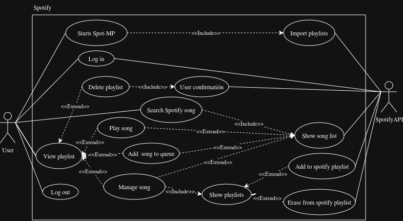

# 
⭐️ Spot-MP ⭐️

---
### Grafico Representativo de Spotify Page:

---

### Casos de Uso Principales (Base)

| Caso de uso: Starts Spot-MP |
| --- |
| **ID:** 9 |
| **Breve descripción:**   El Usuario inicia la aplicación desde la terminal, desencadenando la carga de datos externos. |
| **Actores principales:** Usuario |
| **Actores secundarios:** Ninguno |
| **Precondiciones:**  1. El usuario inicia el programa. |
| **Flujo principal:**   1. El caso de uso empieza cuando el Usuario ejecuta el comando de arranque de Spot-MP.   2. include(ImportPlaylists).   3. El sistema carga la interfaz gráfica principal. |
| **Postcondiciones:**   1. La aplicación está lista para recibir interacciones del Usuario. |
| **Flujos alternativos:**  Ninguno. |

| Caso de uso: Log In |
| --- |
| **ID:** 10 |
| **Breve descripción:**  El Usuario vincula su cuenta premium para autorizar a la aplicación a controlar su música. |
| **Actores principales:** Usuario |
| **Actores secundarios:** SpotifyAPI |
| **Precondiciones:**   1. El Usuario posee credenciales válidas de desarrollador (Client-Id y Client-Secret). |
| **Flujo principal:**   1. El caso de uso empieza cuando el Usuario solicita iniciar sesión.  2. El sistema solicita al Usuario sus credenciales de Spotify.  3. El Usuario ingresa las credenciales.  4. El sistema se comunica con SpotifyAPI para realizar el intercambio de tokens (Authorization Code Flow).   5. SpotifyAPI retorna los tokens de acceso.   6. El sistema guarda los tokens localmente. |
| **Postcondiciones:**  1. El sistema tiene acceso autorizado a los datos privados del Usuario en Spotify. |
| **Flujos alternativos:**   CredencialesInvalidas. |

| Caso de uso: Search Spotify Song |
| --- |
| **ID:** 11 |
| **Breve descripción:**   El Usuario busca una canción específica dentro del catálogo de Spotify. |
| **Actores principales:** Usuario |
| **Actores secundarios:** Ninguno |
| **Precondiciones:**   1. El usuario esta correctamente logueado con su cuenta de Spotify. |
| **Flujo principal:**   1. El caso de uso empieza cuando el Usuario ingresa un término de búsqueda.   2. include(ShowSongList). |
| **Postcondiciones:**   1. El sistema muestra los resultados relevantes al término ingresado. |
| **Flujos alternativos:**   Ninguno. |

| Caso de uso: List Playlist |
| --- |
| **ID:** 12 |
| **Breve descripción:**   El Usuario ingresa a una playlist de Spotify para visualizar las canciones que contiene. |
| **Actores principales:** Usuario |
| **Actores secundarios:** Ninguno |
| **Precondiciones:**   1. Las playlists han sido importadas exitosamente. |
| **Flujo principal:**   1. El caso de uso empieza cuando el Usuario selecciona una playlist específica.   2. El sistema muestra las canciones contenidas en forma de lista.   punto de extensión: Song Interaction (Play Song, Add song to queue, Manage song). |
| **Postcondiciones:**   1. Las canciones de la playlist están visibles en pantalla. |
| **Flujos alternativos:**   Ninguno. |

---

### Casos de Uso de Inclusión (`<<include>>`)

| Caso de uso: Import Playlists |
| --- |
| **ID:** 13 |
| **Breve descripción:**   El sistema obtiene las playlists vinculadas al perfil del Usuario desde los servidores de Spotify. |
| **Actores principales:** Sistema |
| **Actores secundarios:** SpotifyAPI |
| **Precondiciones:**   1. El sistema posee un token de acceso válido de Spotify. |
| **Flujo principal:**   1. El sistema solicita a SpotifyAPI la lista de playlists guardadas por el Usuario.  2. SpotifyAPI retorna los metadatos y URIs de las listas.   3. El sistema carga esta información en la memoria virtual. |
| **Postcondiciones:**   1. Las playlists externas están disponibles para interactuar en la aplicación. |
| **Flujos alternativos:**   FallaDeConexion. |

| Caso de uso: Show Song List |
| --- |
| **ID:** 14 |
| **Breve descripción:**   El sistema procesa la búsqueda y muestra la lista de canciones devueltas por Spotify. |
| **Actores principales:** Sistema |
| **Actores secundarios:** SpotifyAPI |
| **Precondiciones:**   1. El Usuario proporcionó un término de búsqueda. |
| **Flujo principal:**   1. El sistema envía el término de búsqueda a SpotifyAPI.   2. SpotifyAPI retorna un listado de canciones con nombres iguales o parecidos.   3. El sistema muestra la lista estructurada en pantalla.   punto de extensión: Song Interaction (Play Song, Add song to queue, Manage song). |
| **Postcondiciones:**   1. Los resultados de búsqueda están visibles e interactuables. |
| **Flujos alternativos:**   SinResultados. |

| Caso de uso: Show Playlists |
| --- |
| **ID:** 15 |
| **Breve descripción:**   El sistema despliega el menú con las playlists de Spotify para gestionar una canción. |
| **Actores principales:** Sistema |
| **Actores secundarios:** Ninguno |
| **Precondiciones:**   1. El sistema tiene las playlists importadas en memoria. |
| **Flujo principal:**   1. El sistema filtra y muestra únicamente las playlists de Spotify (propias o con permisos).   punto de extensión: Play List Interaction (Add to Spotify playlist, Erase from Spotify playlist). |
| **Postcondiciones:**   1. El menú de playlists está desplegado. |
| **Flujos alternativos:**   Ninguno. |

|Caso de uso: User Confirmation|
|---|
|**ID:** 22|
|**Breve descripción:**  El sistema solicita al Usuario verificar una acción crítica para evitar ejecuciones accidentales mediante un pequeño cartel de confirmación.|
|**Actores principales:** Sistema|
|**Actores secundarios:** Ninguno|
|**Precondiciones:** 1. El Usuario desencadenó un evento que requiere validación de seguridad (ej. eliminar una playlist).|
|**Flujo principal:**  1. El sistema interrumpe el flujo actual y muestra un pequeño cartel de confirmación en pantalla. 2. El Usuario confirma la acción haciendo clic en el botón de aceptar. 3. El sistema retorna la validación exitosa al caso de uso origen para que continúe su ejecución.|
|**Postcondiciones:**  1. La acción crítica es autorizada para finalizar su proceso.|
|**Flujos alternativos:**  AccionCancelada (El Usuario rechaza la confirmación y el proceso se aborta).|

---

### Casos de Uso de Extensión (`<<extend>>`)

| Caso de uso de extensión: Play Song |
| --- |
| **ID:** 16 |
| **Breve descripción:**   Segmento 1: El Usuario inicia la reproducción de una canción proveniente de Spotify. |
| **Actores principales:** Usuario |
| **Actores secundarios:** Ninguno |
| **Segmento 1 precondiciones:**   1. El Usuario resalta una canción válida en la lista de búsqueda o en la playlist. |
| **Segmento 1 flujo:**   1. El Usuario selecciona "reproducir" en la canción.   2. El sistema transfiere el URI de Spotify al motor de reproducción general.   3. El sistema inicia la reproducción mediante *Spotify Connect* (librespot). |
| **Segmento 1 postcondiciones:**   1. El reproductor general se encuentra reproduciendo la canción seleccionada. |

| Caso de uso de extensión: Add Song to Queue |
| --- |
| **ID:** 17 |
| **Breve descripción:**   Segmento 1: El Usuario agrega una canción de Spotify a la cola de reproducción. |
| **Actores principales:** Usuario |
| **Actores secundarios:** Ninguno |
| **Segmento 1 precondiciones:**   1. El Usuario resalta una canción en la lista de búsqueda o en la playlist. |
| **Segmento 1 flujo:**   1. El Usuario selecciona "agregar a la cola" en la canción.   2. El sistema añade la canción a la estructura de prioridad del reproductor. |
| **Segmento 1 postcondiciones:**   1. La canción se encuentra en la cola. |

| Caso de uso de extensión: Manage Song |
| --- |
| **ID:** 18 |
| **Breve descripción:**   Segmento 1: El Usuario decide administrar las listas a las que pertenece una canción de Spotify. |
| **Actores principales:** Usuario |
| **Actores secundarios:** Ninguno |
| **Segmento 1 precondiciones:**   1. El Usuario resalta una canción en la lista de búsqueda o en la playlist. |
| **Segmento 1 flujo:**   1. El Usuario abre el menú de opciones de la canción.   2. include(ShowPlaylists). |
| **Segmento 1 postcondiciones:**   1. Las opciones de modificación están habilitadas. |

| Caso de uso de extensión: Add to Spotify Playlist |
| --- |
| **ID:** 19 |
| **Breve descripción:**   Segmento 1: El Usuario vincula la canción actual a una playlist modificable de Spotify. |
| **Actores principales:** Usuario |
| **Actores secundarios:** SpotifyAPI |
| **Segmento 1 precondiciones:**   1. La canción no pertenece a la playlist elegida. |
| **Segmento 1 flujo:**   1. El Usuario marca una playlist de Spotify.   2. El sistema envía la petición de inserción (URI de canción y URI de playlist) a SpotifyAPI.   3. SpotifyAPI confirma la modificación.   4. El sistema actualiza el estado visual de la interfaz. |
| **Segmento 1 postcondiciones:**   1. La playlist en el perfil real de Spotify del Usuario ha sido actualizada. |

| Caso de uso de extensión: Erase from Spotify Playlist |
| --- |
| **ID:** 20 |
| **Breve descripción:**   Segmento 1: El Usuario elimina la canción actual de una playlist de Spotify a la que ya pertenecía. |
| **Actores principales:** Usuario |
| **Actores secundarios:** SpotifyAPI |
| **Segmento 1 precondiciones:**   1. La canción pertenece a la playlist elegida y la playlist es de propiedad del Usuario (modificable). |
| **Segmento 1 flujo:**   1. El Usuario desmarca la playlist de Spotify.   2. El sistema envía la petición de eliminación a SpotifyAPI.   3. SpotifyAPI confirma la eliminación.  4. El sistema actualiza el estado visual de la interfaz. |
| **Segmento 1 postcondiciones:**   1. La canción ha sido eliminada del perfil real de Spotify del Usuario. |

|Caso de uso de extensión: Delete Playlist|
|---|
|**ID:** 23|
|**Breve descripción:**  Segmento 1: El Usuario decide borrar por completo una playlist desde la vista de spotify.|  
|**Actores principales:** Usuario|
|**Actores secundarios:** SpotifyAPI|
|**Segmento 1 precondiciones:**  1. El Usuario se encuentra interactuando con una playlist específica en la lista.|  
|**Segmento 1 flujo:**  1. El Usuario presiona el botón de eliminar correspondiente a la playlist seleccionada. 2. include(User Confirmation). 3. El sistema solicita a SpotifyAPI la eliminación de la playlist. 4. El sistema actualiza la interfaz removiendo la playlist de la lista visual.|  
|**Segmento 1 postcondiciones:**  1. La playlist deja de existir en el almacenamiento local y en el perfil de Spotify del Usuario.|

